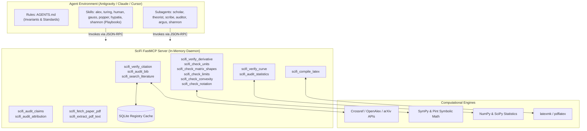

# 🔬 SciFi — Scientific Research & Academic Writing Toolkit

[](https://python.org)
[](https://modelcontextprotocol.io)
[](https://antigravity.google)
[](tests/)
[](LICENSE)

> **Zero-Hallucination Citations · Symbolic Calculus Auditing · Humanized Academic Prose · FastMCP Daemon**
>
> *SciFi transforms AI coding agents (OpenCode, Claude Code, VS Code / Cline & Roo Code, Cursor, Windsurf, Antigravity) into rigorous, peer-review-grade research partners.*

---

## 💡 Why SciFi?

Large Language Models are exceptional coders, but notoriously fragile in scientific publication:

| LLM Vulnerability | The Academic Consequence | How SciFi Solves It |
|---|---|---|
| **Hallucinated DOIs & References** | Retracted papers cited, ghost citations created | **Alex:** Real-time cross-referencing against Crossref, OpenAlex, arXiv, and DataCite with local SQLite caching. |
| **Silent Algebraic Slips** | Erroneous signs, mismatched matrix shapes, broken limit steps | **Turing:** In-memory SymPy calculus, Pint physical dimensional homogeneity, and Sylvester convexity audits. |
| **Synthetic AI Tropes ("Slop")** | Papers rejected upfront for *"delve"*, *"tapestry"*, em dashes, and marketing buzz | **Human:** Master Academic Humanizer protocol enforcing epistemic hedging, passive voice, and objective tone. |
| **Uncredited Methods** | Reviewers challenge lack of attribution or prior art novelty | **Argus:** Automated scanning for uncredited algorithms, canonical auto-citing, and delta-novelty matrix generation. |
| **Unhedged Overclaims** | Sweeping claims (*"outperforms all existing"*, *"optimal"*) without proofs | **Popper:** Adversarial Reviewer 2 stress-testing for unstated physical assumptions and baseline fairness. |
| **Weak Title & Vague Abstract** | Desk-rejected in 30 seconds or buried in search | **Shannon:** Publication-grade title engineering, 5-beat dual-audience abstract, and academic SEO/keyword optimization. |

---

## ⚡ 30-Second Quickstart

Requires Python ≥ 3.12 and [`uv`](https://docs.astral.sh/uv/).

### 1. Installation
```bash
# Clone the repository
git clone https://github.com/Betagors/scifi.git
cd scifi

# Install dependencies and sync virtual environment
uv sync
```

### 2. Configure Your AI Agents (One Command)
SciFi includes an automated setup installer that auto-discovers and configures OpenCode, Claude Code, VS Code (Cline & Roo Code), Cursor, Windsurf, Claude Desktop, and Antigravity:

```bash
# Auto-configure all detected AI environments globally
uv run sf setup --auto

# Configure repository workspace manifests (.cursor, .mcp.json, opencode.json)
uv run sf setup --workspace

# Synchronize academic rules to CLAUDE.md, .clinerules, .cursorrules, etc.
uv run sf sync

# List all supported environments and their detection status
uv run sf setup --list

# Or preview configuration non-destructively
uv run sf setup --dry-run
```

### 3. Verify Anything from Your Terminal
Use the high-speed `sf` (or `scifi`) command:

```bash
# 🔍 Verify a paper by DOI or link against global registries
uv run sf v 10.1038/s41586-020-2649-2

# 📑 Audit an entire .bib file for retractions and missing DOIs
uv run sf a references.bib --output-report audit.md --output-bib clean.bib

# 🏗️ Compile a LaTeX paper and diagnose build errors
uv run sf c paper.tex

# 🛡️ Audit attribution gaps and auto-inject citations into LaTeX
uv run sf cite paper.tex --bib references.bib --fix

# 🚀 Start the in-memory FastMCP server daemon
uv run sf mcp
```

---

## 🏛️ Architecture: Tripartite Model

SciFi separates **deterministic computation** (tools) from **cognitive reasoning** (skills), wrapped in **strict invariants** (rules):



---

## ⌨️ Unified CLI & Shortcut Aliases (`sf`)

Every command is available through `scifi` and its short alias `sf`, complete with single-letter shortcuts:

| Full Command | Short Alias | Description |
|---|---|---|
| `scifi verify <id>` | `sf v <id>` / `sf check` | Verify DOI/link/arXiv against Crossref, OpenAlex, and arXiv |
| `scifi audit <bib>` | `sf a <bib>` | Audit `.bib` file, flag retractions, fill missing DOIs, export clean BibTeX |
| `scifi search "<title>"` | `sf s "<title>"` / `sf find` | Search global academic registries by title |
| `scifi compile [tex]` | `sf c [tex]` / `sf build` | Compile LaTeX manuscript via `latexmk`/`pdflatex` with file:line log diagnosis |
| `scifi argus <file>` | `sf cite <file>` | Audit text for uncredited methods and auto-inject citations |
| `scifi setup` | `sf init` / `sf i` | Configure SciFi FastMCP server in OpenCode, Claude, Cursor, Cline, Roo, Windsurf |
| `scifi sync` | `sf sync` | Synchronize SciFi scientific rules to CLAUDE.md, .clinerules, .cursorrules, etc. |
| `scifi server` | `sf mcp` / `sf serve` | Launch the persistent FastMCP JSON-RPC daemon over stdio |

---

## 🛠️ FastMCP Server Tool Reference (17 Tools)

When SciFi is enabled, coding agents interact directly with these 17 structured JSON-RPC primitives:

### 1. Literature & Bibliographic Integrity (Alex)
- **`scifi_verify_citation`**: Validates DOIs, arXiv URLs, PubMed links, or publisher URLs against global registries. Detects retractions, published errata, and metadata discrepancies.
- **`scifi_audit_bib`**: Scans complete `.bib` bibliographies, sanitizes citekeys (`[Author][Year][Word]`), flags retractions, and searches missing DOIs.
- **`scifi_search_literature`**: Queries OpenAlex and academic registries for canonical literature by title or query string.

### 2. Attribution & Plagiarism Audit (Argus)
- **`scifi_audit_attribution`**: Scans manuscripts for uncredited algorithms and methods. Categorizes into `CANONICAL_ACADEMIC`, `COMMON_KNOWLEDGE`, `INFORMAL_WEB`, or `PREPRINT_ALIGNMENT`. Supports `--fix` for automatic citation injection.

### 3. Symbolic Mathematics & Calculus (Turing)
- **`scifi_verify_derivative`**: Verifies that $\frac{d}{dx}f(x)$ matches claimed results symbolically via SymPy (`VALID` or `INVALID_DERIVATION`).
- **`scifi_verify_derivation_step`**: Verifies step-by-step calculus equivalence ($LHS - RHS = 0$) under specified mathematical assumptions.
- **`scifi_check_units`**: Validates dimensional consistency using Pint in equation mode (`eq`) or additive term mode (`terms`).
- **`scifi_check_matrix_shapes`**: Validates matrix and tensor products symbolically with AST expression safety.
- **`scifi_check_limits`**: Checks analytical boundaries ($N \to \infty$) and one-sided limits ($x \to 0^+$).
- **`scifi_check_convexity`**: Computes the symbolic Hessian and tests positive/negative definiteness via Sylvester's criterion (`strictly_convex`, `convex`, `strictly_concave`, `concave`, `indefinite`).
- **`scifi_check_notation`**: Scans LaTeX manuscripts for symbol variance ($P, p, \mathbf{P}, \boldsymbol{P}$) and undefined notation.

### 4. Empirical Sanity & Statistics (Gauss)
- **`scifi_verify_curve`**: Compares closed-form theoretical formulas against empirical simulation datasets (CSV, JSON, or inline arrays) with relational equation and power syntax support.
- **`scifi_audit_statistics`**: Computes sample mean, standard error, 95% confidence intervals, and flags violations of the Central Limit Theorem ($N < 30$).

### 5. Adversarial Review & Methodology (Popper)
- **`scifi_audit_claims`**: Scans text for unhedged impact statements, sweeping superiority claims (*"outperforms all existing"*), unproven optimality, or fragile assumptions.

### 6. LaTeX Engine (Compiler)
- **`scifi_compile_latex`**: Autonomous TeX compilation (`latexmk`/`pdflatex`), auxiliary cleanup, and structured error log extraction.

### 7. Open-Access Paper Retrieval (Hypatia)
- **`scifi_fetch_paper_pdf`**: Downloads open-access paper PDFs by DOI or arXiv ID via arXiv API and Unpaywall.
- **`scifi_extract_pdf_text`**: Extracts structured text and sections (Abstract, System Model/Method, Limitations, Conclusions) from paper PDFs.

---

## 🧠 Cognitive Skill Playbooks

SciFi includes 9 modular on-demand skill playbooks:

| Skill | Focus | Primary Tools / Protocol |
|---|---|---|
| [`alex`](skills/alex/SKILL.md) | Citation & Literature Verification | `scifi_verify_citation`, `scifi_audit_bib`, `scifi_search_literature` |
| [`argus`](skills/argus/SKILL.md) | Academic Attribution & Plagiarism Sentinel | `scifi_audit_attribution`, canonical auto-cite |
| [`turing`](skills/turing/SKILL.md) | Mathematical & Symbolic Derivations | `scifi_verify_derivative`, `scifi_check_units`, `scifi_check_notation`, etc. |
| [`gauss`](skills/gauss/SKILL.md) | Numerical Sanity & Statistical Auditing | `scifi_verify_curve`, `scifi_audit_statistics` |
| [`human`](skills/human/SKILL.md) | Academic Prose Humanizer | Master Academic Humanizer protocol (de-biasing, tone hedging, passive voice) |
| [`popper`](skills/popper/SKILL.md) | Adversarial Peer-Review & Falsification | `scifi_audit_claims`, 4-axis hostile Reviewer 2 audit |
| [`compiler`](skills/compiler/SKILL.md) | Autonomous LaTeX Compilation | `scifi_compile_latex`, error isolation and auto-install |
| [`hypatia`](skills/hypatia/SKILL.md) | Literature Synthesis & Benchmark Matrix | `scifi_fetch_paper_pdf`, `scifi_extract_pdf_text`, Delta-Novelty Matrix |
| [`shannon`](skills/shannon/SKILL.md) | Title, Abstract & SEO Optimization | `test_keywords.py`, 5-beat dual-audience abstract, SEO tricks, 100-point rubric |

---

## 🤖 Specialized Subagents

SciFi provides 6 pre-configured autonomous personas in `agents/`:

* **`scholar`**: Literature synthesis, competitive benchmarking, and Related Work taxonomies.
* **`theorist`**: Symbolic proofs, Lemma formulations, and dimensional consistency checks.
* **`scribe`**: LaTeX typesetting, AI-cliché eradication, and mathematical notation harmonization.
* **`auditor`**: Hostile peer-review simulation, unstated assumption hunting, and baseline fairness audits.
* **`argus`**: Attribution guardian detecting uncredited algorithms and triaging web sources.
* **`shannon`**: Academic title engineering, 5-beat cognitive abstracts, search engine optimization (SEO), and non-redundant indexing keyword strategy.

---

## 🔌 Client Integration

### Antigravity
SciFi is a native Antigravity plugin. Antigravity automatically detects `plugin.json` and loads the FastMCP daemon from `mcp_config.json`:
```json
{
  "mcpServers": {
    "scifi": {
      "command": "uv",
      "args": ["run", "python", "-m", "scifi.server"]
    }
  }
}
```

### Claude Desktop
Run `uv run sf setup --auto` or add to your `claude_desktop_config.json`:
```json
{
  "mcpServers": {
    "scifi": {
      "command": "uv",
      "args": ["run", "python", "-m", "scifi.server"],
      "cwd": "/path/to/scifi"
    }
  }
}
```

### Cursor
Run `uv run sf setup --auto` or add to `.cursor/mcp.json`:
```json
{
  "mcpServers": {
    "scifi": {
      "command": "uv",
      "args": ["run", "python", "-m", "scifi.server"],
      "cwd": "/path/to/scifi"
    }
  }
}
```

---

## 🧪 Running Tests

The test suite contains **178 unit and integration tests** covering all modules:

```bash
uv run pytest tests/ -v
```

---

## 📄 Citing SciFi

If you use SciFi in your research or scientific manuscripts, please cite:

```bibtex
@software{scifi2026,
  author = {SciFi Contributors},
  title = {SciFi: Scientific Research & Academic Writing Toolkit for AI Agents},
  year = {2026},
  publisher = {GitHub},
  journal = {GitHub repository},
  url = {https://github.com/Betagors/scifi}
}
```

---

## 📜 License

Distributed under the [MIT License](LICENSE).
