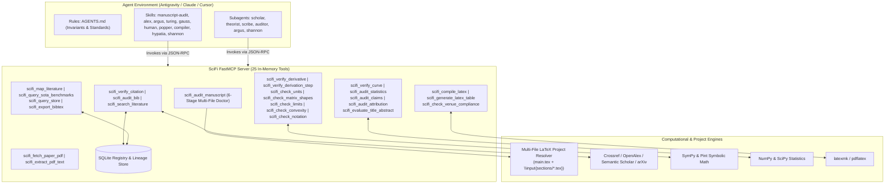

# 🔬 SciFi — Scientific Research & Academic Writing Toolkit

[](https://python.org)
[](https://modelcontextprotocol.io)
[](https://antigravity.google)
[](tests/)
[](LICENSE)

> **Zero-Hallucination Citations · Multi-File LaTeX Readiness · Symbolic Calculus Auditing · SOTA Literature Lineage · 32 FastMCP Tools**
>
> *SciFi transforms AI coding agents (Antigravity, Claude Code, Cursor, VS Code / Cline & Roo Code, Windsurf, OpenCode) and your terminal into a rigorous, peer-review-grade research partner.*

---

## 💡 Why SciFi?

Large Language Models are exceptional coders, but notoriously fragile in scientific publication:

| LLM Vulnerability | The Academic Consequence | How SciFi Solves It |
|---|---|---|
| **Hallucinated DOIs & References** | Retracted papers cited, ghost citations created | **Alex:** Real-time cross-referencing against Crossref, OpenAlex, arXiv, and DataCite with local SQLite caching. |
| **Multi-File LaTeX Blindness** | Tools only check `main.tex` and miss `\input{sections/...}` clashes | **Project Resolver & Doctor:** Recursively expands `\input`, `\include`, `\subfile`, and `.bib` files with exact `sections/*.tex:line` provenance. |
| **Silent Algebraic Slips** | Erroneous signs, mismatched matrix shapes, broken limit steps | **Turing:** In-memory SymPy calculus, Pint physical dimensional homogeneity, Sylvester convexity, and cross-section notation audits. |
| **Synthetic AI Tropes & LaTeX Markup Fingerprints** | Papers rejected upfront for *"delve"*, `\item \textbf{...}:` clones, `\text{where }` inside display math, and low sentence burstiness | **Human (`sf human`):** 6-dimension LaTeX source-code & stylometric forensic auditor plus Master Academic Humanizer protocol. |
| **Uncredited Methods** | Reviewers challenge lack of attribution or prior art novelty | **Argus:** Automated scanning for uncredited algorithms, canonical auto-citing, and delta-novelty matrix generation. |
| **Unhedged Overclaims & Leaks** | Sweeping claims (*"outperforms all existing"*), double-blind leaks, `\vspace` hacks | **Popper & Venue:** Adversarial Reviewer 2 stress-testing, double-blind anonymization checks, and layout compliance. |
| **Weak Title & Vague Abstract** | Desk-rejected in 30 seconds or buried in search | **Shannon:** Publication-grade title engineering, 5-beat dual-audience abstract, and 100-point Reviewer Triage Scorecard. |

---

## ⚡ 30-Second Quickstart

Requires Python ≥ 3.12 and [`uv`](https://docs.astral.sh/uv/).

### 1. Installation
```bash
# Clone the repository
git clone https://github.com/Betagors/scifi.git
cd scifi

# Install dependencies (and optional dev test suite)
uv sync --extra dev

# Or run directly without cloning via uvx:
uvx --from git+https://github.com/Betagors/scifi sf --help
```

### 2. Configure Your AI Agents & API Polite Pool
SciFi includes an automated setup installer that auto-discovers and configures Antigravity, Claude Code, Claude Desktop, Cursor, VS Code (Cline & Roo Code), Windsurf, and OpenCode:

```bash
# Auto-configure all detected AI environments globally
uv run sf setup --auto

# Configure repository workspace manifests (.cursor, .mcp.json, opencode.json)
uv run sf setup --workspace

# Synchronize academic rules to CLAUDE.md, .clinerules, .cursorrules, AGENTS.md
uv run sf sync

# Set your Polite-Pool email for faster Crossref / OpenAlex / Unpaywall lookups
uv run sf config set email researcher@university.edu

# Initialize a per-paper project configuration (scifi.toml)
uv run sf config init --main-tex main.tex --bib-file references.bib --venue ieee --double-blind
```

### 3. Audit & Verify Anything from Your Terminal
Use the unified `sf` (or `scifi`) command across single-file (`paper.tex`) or multi-file (`main.tex` + `sections/*.tex`) LaTeX projects:

```bash
# 🩺 Run the 6-stage Peer-Review Readiness Pipeline across a multi-file LaTeX project
uv run sf doctor ./my_paper_dir --venue neurips --double-blind --output readiness_report.md

# 🔍 Verify a paper by DOI or link against global registries
uv run sf v 10.1038/s41586-020-2649-2

# 📑 Audit an entire .bib file for retractions and missing DOIs
uv run sf a references.bib --output-report audit.md --output-bib clean.bib

# 🗺️ Map intellectual lineage, research gaps, and SOTA benchmarks into an interactive HTML graph
uv run sf lit map "Attention Is All You Need" --depth 2 --output-dir ./lit_review

# 📊 Generate a publication-grade LaTeX booktabs table with bolded best & underlined second-best metrics
uv run sf table results.csv --lower-better Latency,RMSE --output tables/main_results.tex

# 🏷️ Score manuscript Title, 5-Beat Abstract, and Keywords on the 100-point Reviewer Triage rubric
uv run sf shannon ./my_paper_dir --live

# 🕵️ Check double-blind anonymization leaks, negative \vspace hacks, and unreferenced floats
uv run sf venue ./my_paper_dir --venue icml --double-blind

# 📦 Generate complete academic submission bundle (cover letter, highlights, title page, code zip)
uv run sf submission bundle --target ./my_paper_dir --journal "Pattern Recognition" --venue elsevier
```

---

## 🏛️ Architecture: Tripartite Model

SciFi separates **deterministic computation** (25 FastMCP tools) from **cognitive reasoning** (9 skills), wrapped in **strict academic invariants** (rules):



---

## ⌨️ Unified CLI & Shortcut Aliases (`sf`)

Every capability is available through `scifi` and its short alias `sf`:

| Full Command | Short Alias | Description |
|---|---|---|
| `scifi doctor [path]` | `sf doc [path]` / `sf check-paper` | **6-Stage Manuscript Readiness Audit** across `main.tex` + `sections/*.tex` + `.bib` |
| `scifi verify <id>` | `sf v <id>` / `sf check` | Verify DOI/link/arXiv against Crossref, OpenAlex, and arXiv |
| `scifi audit <bib>` | `sf a <bib>` | Audit `.bib` file, flag retractions, fill missing DOIs, export clean BibTeX |
| `scifi search "<title>"` | `sf s "<title>"` / `sf find` | Search global academic registries by title |
| `scifi literature <cmd>` | `sf lit < map \| sota \| query \| export-bib >` | Map citation lineage, SOTA benchmarks, and interactive HTML graphs |
| `scifi argus <path>` | `sf cite <path>` | Audit single or multi-file manuscript for uncredited methods & auto-cite |
| `scifi math <cmd>` | `sf m < derivative \| step \| units \| shapes \| limits \| convexity \| notation >` | Run Turing symbolic calculus, unit homogeneity, and cross-section notation checks |
| `scifi stats <cmd>` | `sf gauss < curve \| audit >` | Verify theoretical curves against simulation data & audit 95% CIs |
| `scifi review <path>` | `sf popper <path>` / `sf claims` | Scan single or multi-file manuscript for overclaims & fragile assumptions |
| `scifi shannon [path]` | `sf seo [path]` / `sf abstract` | Score Title, 5-Beat Abstract, and Keywords on 100-point Reviewer Triage rubric |
| `scifi human [path]` | `sf humanize [path]` / `sf deai` | Audit LaTeX source code & prose across 6 forensic AI-detection dimensions ($R_{\mathrm{IB}}$, $\mu_{\mathrm{macro}}$, $\rho_{\mathrm{math\_text}}$, $B_{\mathrm{length}}$) |
| `scifi table <data>` | `sf tab <data>` / `sf booktabs` | Generate LaTeX `booktabs` tables with auto-bolded best & underlined second-best metrics |
| `scifi venue [path]` | `sf blind [path]` | Audit manuscript for double-blind anonymization leaks, `\vspace` hacks & unreferenced floats |
| `scifi figures [path]` | `sf fig [path]` / `sf da-vinci` | Audit figures for DPI, vector formats, subfigure parity, and colorblind safety |
| `scifi trim [path]` | `sf budget [path]` / `sf layout` | Analyze page budget slack, paragraph widow lines, and BibTeX abbreviation savings |
| `scifi proofs [path]` | `sf theorems [path]` / `sf euclid` | Audit theorem-proof completeness and verify appendix derivation pointers |
| `scifi repro [path]` | `sf bacon [path]` / `sf repro` | Audit conference reproducibility checklist (seeds, error bars, compute budget, anonymization) |
| `scifi rebuttal <cmd>` | `sf socrates` / `sf response` | Author rebuttal generator (`sf rebuttal format`) and LaTeX revision diff tracker (`sf rebuttal diff`) |
| `scifi config <cmd>` | `sf cfg < show \| set \| init >` | Manage `~/.scifi/config.json` API keys/polite-pool email and workspace `scifi.toml` |
| `scifi compile [tex]` | `sf c [tex]` / `sf build` | Compile LaTeX manuscript via `latexmk`/`pdflatex` with `file:line` log diagnosis |
| `scifi setup` | `sf init` / `sf i` | Configure SciFi FastMCP server in Antigravity, Claude, Cursor, Cline, Roo, Windsurf |
| `scifi sync` | `sf sync` | Synchronize SciFi scientific rules to `CLAUDE.md`, `.clinerules`, `.cursorrules`, `AGENTS.md` |
| `scifi server` | `sf mcp` / `sf serve` | Launch the persistent FastMCP JSON-RPC daemon over stdio or SSE |

---

## 🛠️ FastMCP Server Tool Reference (32 Tools)

When SciFi is enabled, coding agents interact directly with these 25 structured JSON-RPC primitives:

### 1. End-to-End Manuscript Readiness (Doctor)
- **`scifi_audit_manuscript`**: Executes the complete 6-stage readiness audit across single-file or multi-file (`main.tex` + `sections/*.tex`) LaTeX projects, returning a 0–100 Readiness Score and Markdown report.

### 2. Literature & Bibliographic Integrity (Alex)
- **`scifi_verify_citation`**: Validates DOIs, arXiv URLs, PubMed links, or publisher URLs against global registries. Detects retractions, published errata, and metadata discrepancies.
- **`scifi_audit_bib`**: Scans complete `.bib` bibliographies, sanitizes citekeys (`[Author][Year][Word]`), flags retractions, and searches missing DOIs.
- **`scifi_search_literature`**: Queries OpenAlex and academic registries for canonical literature by title or query string.

### 3. Literature Lineage & SOTA Intelligence (Discovery)
- **`scifi_map_literature`**: Crawls backward (foundational) and forward (frontier) citations, extracts research gaps and empirical claims, persists to `.scifi/literature_store.db`, and exports an interactive HTML graph (`literature_map.html`), Markdown report, and `references.bib`.
- **`scifi_query_sota_benchmarks`**: Queries canonical benchmarks, evaluation metrics, and current state-of-the-art leaders and performance deltas.
- **`scifi_query_store`**: Executes read-only SQL `SELECT` queries against the local literature intelligence SQLite store.
- **`scifi_export_bibtex`**: Exports verified BibTeX entries for any stored literature graph session.

### 4. Attribution & Plagiarism Audit (Argus)
- **`scifi_audit_attribution`**: Scans single or multi-file manuscripts for uncredited algorithms and methods (`CANONICAL_ACADEMIC`, `COMMON_KNOWLEDGE`, `INFORMAL_WEB`, `PREPRINT_ALIGNMENT`). Supports `--fix` for automatic citation injection.

### 5. Symbolic Mathematics & Calculus (Turing)
- **`scifi_verify_derivative`**: Verifies that $\frac{d^n}{dx^n}f(x)$ matches claimed results symbolically via SymPy.
- **`scifi_verify_derivation_step`**: Verifies step-by-step calculus equivalence ($LHS - RHS = 0$) under specified mathematical assumptions.
- **`scifi_check_units`**: Validates dimensional consistency using Pint in equation mode (`eq`) or additive term mode (`terms`).
- **`scifi_check_matrix_shapes`**: Validates matrix and tensor products symbolically with AST expression safety.
- **`scifi_check_limits`**: Checks analytical boundaries ($N \to \infty$) and one-sided limits ($x \to 0^+$).
- **`scifi_check_convexity`**: Computes the symbolic Hessian and tests positive/negative definiteness via Sylvester's criterion.
- **`scifi_check_notation`**: Scans single or multi-file LaTeX manuscripts (`main.tex` + `sections/*.tex`) for symbol variance ($P, p, \mathbf{P}, \boldsymbol{P}$) across sections.

### 6. Empirical Sanity & Statistics (Gauss)
- **`scifi_verify_curve`**: Compares closed-form theoretical formulas against empirical simulation datasets (CSV, JSON, or inline arrays).
- **`scifi_audit_statistics`**: Computes sample mean, standard error, 95% confidence intervals, and flags violations of the Central Limit Theorem ($N < 30$).

### 7. Adversarial Review, Humanizer Stylometry, Venue Compliance & Title/Abstract SEO (Popper, Human, Venue & Shannon)
- **`scifi_audit_claims`**: Scans single or multi-file manuscripts for unhedged impact statements, sweeping superiority claims, unproven optimality, or fragile assumptions.
- **`scifi_audit_human`**: Audits LaTeX source code and academic prose across 6 forensic dimensions: list bold-colon templates ($R_{\mathrm{IB}}$ & item length $\mathrm{CV}$), preamble package hygiene, tabular column rigidity, macro abstraction ratio ($\mu_{\mathrm{macro}}$), mathematical syntax artifacts ($\rho_{\mathrm{math\_text}}$, un-scoped word subscripts, trapped punctuation), and prose stylometry (Kobak et al. excess AI vocabulary, em-dashes, and sentence-length burstiness $B_{\mathrm{length}}$).
- **`scifi_evaluate_title_abstract`**: Evaluates title, 5-beat abstract, and keywords (or auto-extracts them from `main.tex` + `sections/abstract.tex`) on the 100-point Reviewer Triage Scorecard.
- **`scifi_check_venue_compliance`**: Audits multi-file LaTeX manuscripts for double-blind anonymization leaks, forbidden negative `\vspace` / margin hacks, and unreferenced floats.

### 8. LaTeX Compilation & Publication Tables (Compiler & Tables)
- **`scifi_compile_latex`**: Autonomous TeX compilation (`latexmk`/`pdflatex`), auxiliary cleanup, and structured error log extraction.
- **`scifi_generate_latex_table`**: Generates publication-ready LaTeX `booktabs` tables from CSV/JSON data with automatic `\textbf` best and `\underline` second-best formatting.

### 9. Open-Access Paper Retrieval (Hypatia)
- **`scifi_fetch_paper_pdf`**: Downloads open-access paper PDFs by DOI or arXiv ID via arXiv API and Unpaywall.
- **`scifi_extract_pdf_text`**: Extracts structured text and sections from paper PDFs.

---

### 10. Visual Accessibility, Page Budget, Proofs, Reproducibility & Rebuttal (Da Vinci, Layout, Euclid, Bacon & Socrates)
- **`scifi_audit_figures`**: Audits figures in LaTeX manuscripts for print resolution (min DPI >= 300), vector vs raster format for plots, subfigure parity ((a), (b), (c) referenced in prose), and colorblind safety (red/green curve collisions).
- **`scifi_trim_budget`**: Analyzes LaTeX manuscripts and BibTeX bibliographies for legitimate line savings: prunes 1-3 words from widow lines, condenses verbose venue titles with standard ISO-4/IEEE abbreviations, and suggests float compaction.
- **`scifi_audit_proofs`**: Detects orphan theorems, lemmas, and propositions lacking inline proofs or explicit pointers to appendix derivations, and verifies target appendix labels.
- **`scifi_audit_reproducibility`**: Audits submissions against conference reproducibility checklists (NeurIPS/ICML/IEEE): random seeds, trial repetitions, error bars, compute budget disclosures, and double-blind repository sanitization.
- **`scifi_format_rebuttal`**: Parses raw reviewer comments to scaffold disciplined, 4-beat point-by-point rebuttal markdown documents with scholarly etiquette.
- **`scifi_diff_manuscript`**: Performs section-by-section LaTeX diff tracking, generates markdown diff ledgers, and automates marked-up `latexdiff` PDF generation.

---

## 🧪 Running Tests

The test suite contains **419+ unit and integration tests** covering all modules, CLI commands, and multi-file LaTeX workflows:

```bash
uv run pytest tests/ -v
```

---

## 📄 Citing SciFi

If you use SciFi in your research or scientific manuscripts, please cite:

```bibtex
@software{scifi2026,
  author = {SciFi Contributors},
  title = {SciFi: Scientific Research & Academic Writing Toolkit for AI Agents},
  year = {2026},
  version = {1.0.0},
  publisher = {GitHub},
  url = {https://github.com/Betagors/scifi}
}
```

---

## 📜 License

Distributed under the [MIT License](LICENSE).
