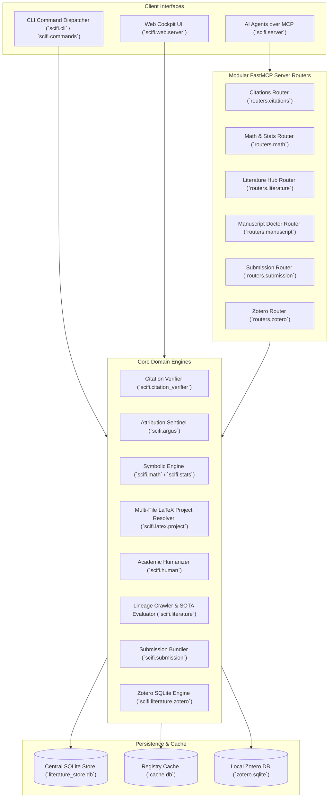

# Architecture

SciFi is built on a modular, decoupled architecture designed to serve both human CLI operators and autonomous AI agents over FastMCP.

---

## Architectural Overview

---

## Domain Modules & Responsibilities

### 1. FastMCP Server Routers (`scifi/server/routers/`)
The FastMCP server exposes 46 high-level tools partitioned into 6 domain routers:
- **`citations.py`**: Citation verification, BibTeX auditing, registry search, and Argus uncredited method scanning.
- **`math.py`**: Derivatives, calculus derivation steps, dimensional units, matrix shapes, analytical limits, convexity, and curve fitting.
- **`manuscript.py`**: LaTeX compilation, adversarial claims detection, full 6-stage manuscript doctor, table generation, venue compliance, humanizer prose audit, figure accessibility, budget trimming, proof resolution, and double-blind diffing.
- **`literature.py`**: Open-access PDF retrieval, structured text extraction, lineage discovery graphs, canonical SOTA queries, SQL store inspection, BibTeX exports, and reprint requests.
- **`submission.py`**: Highlights character ceiling validation, standalone unblinded title pages, publisher cover letters, scrubbed anonymous code ZIPs, and complete submission bundles.
- **`zotero.py`**: Local Zotero library status, collection paper retrieval, PDF highlights/notes, and non-destructive audit card push.

### 2. Multi-File LaTeX Project Resolver (`scifi/latex/project.py`)
Scientific manuscripts often split content across multiple files (`\input{sec/methods}`, `\include{results}`). SciFi models this via `LatexProject`:
- Scans `\input{}`, `\include{}`, and `\subfile{}` recursively.
- Resolves relative paths across subdirectories.
- Reconstructs full document text with exact file and line mappings.

### 3. Central Knowledge Store (`scifi/literature/store.py`)
All literature intelligence is stored in a SQLite database (`~/.scifi/literature_store.db`) protected by thread locks and SQLite authorizer callbacks:
- **Tables**: `papers`, `citations`, `graphs`, `paper_gaps`, `benchmarks`, `benchmark_results`, `projects`, `reprint_requests`.
- **Read-Only Authorizer**: The `scifi_query_store` tool enforces strict read-only execution via SQLite authorizers, rejecting `INSERT`, `UPDATE`, `DELETE`, `DROP`, or `ALTER` statements.

### 4. Resilient Network Layer (`scifi/network/client.py`)
External registry requests to Crossref, OpenAlex, Unpaywall, and arXiv use an exponential-backoff session:
- Standard HTTP connection pooling.
- Automatic retries on HTTP 429 (Rate Limit) and 5xx errors.
- Polite User-Agent headers compliant with academic registry etiquette.
