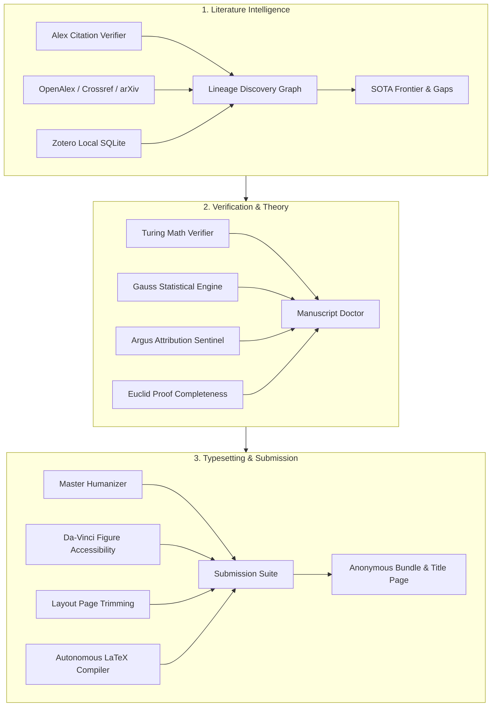

# SciFi Toolkit

**SciFi** is a scientific research and academic writing toolkit built for AI coding assistants and researchers. It provides rigorous tooling across literature discovery, citation integrity, mathematical verification, LaTeX source humanization, figure accessibility, and publication packaging.

---

## Key Pillars

### 1. Literature Intelligence & Discovery
- **Zero-Hallucination Citation Verification (`alex`)**: Cross-references DOIs, arXiv IDs, and BibTeX files against authoritative registries (Crossref, OpenAlex, arXiv, DataCite) with caching and retraction detection.
- **Intellectual Lineage Mapping (`hypatia`)**: Traces foundational citations backward and frontier developments forward, extracting open research gaps and SOTA benchmark leaders.
- **Zotero Zero-Copy Integration**: Directly reads local Zotero SQLite databases (`zotero.sqlite`), accesses annotations, and non-destructively stages audit cards.
- **Author Reprint Automation**: Drafts academic-standard reprint requests for paywalled articles with polite author correspondence mailto links.

### 2. Mathematical Rigor & Adversarial Peer Review
- **Symbolic Derivation Verification (`turing`)**: Uses SymPy to audit symbolic calculus, Jacobians, Hessians, and optimality conditions.
- **Dimensional Homogeneity & Units**: Verifies physical unit consistency across additive and equality expressions using Pint.
- **Matrix & Tensor Shapes**: Verifies matrix dimensions, tensor contractions, and vector operations.
- **Empirical Curve Verification (`gauss`)**: Aligns theoretical closed-form expressions with numerical simulation datasets.
- **Adversarial Falsification (`popper`)**: Stress-tests manuscripts for unstated assumptions, unsupported claims, and weak baselines.

### 3. LaTeX Humanization & Pre-Submission Packaging
- **Master Academic Humanizer (`human`)**: Eradicates AI writing clichés (Kobak et al. lexical markers) and synthetic LaTeX fingerprints (`\item \textbf{...}:` clones, zero-macro expansions).
- **Scientific Figure Accessibility (`da-vinci`)**: Audits graphics for 300+ DPI print resolution, vector formats, subfigure parity, and colorblind safety.
- **Page Budget Trimming (`layout`)**: Reclaims vertical page lines by pruning widow lines and condensing venue titles without illegal `\vspace` hacks.
- **One-Shot Submission Suite (`submission`)**: Generates publisher-compliant cover letters, highlights, standalone double-blind title pages, and scrubbed anonymous code ZIPs.

---

## Interfaces

SciFi is accessible through three complementary interfaces:

1. **CLI Commands (`sf` / `scifi`)**: 20+ specialized terminal commands for local execution and CI/CD pipelines.
2. **FastMCP Server (46 Tools)**: Model Context Protocol daemon for seamless integration with Claude Code, Cursor, Antigravity, OpenCode, and Gemini.
3. **Web Cockpit UI (`sf ui`)**: Browser-based research dashboard for managing projects, graphs, reprint requests, and literature lineage.
