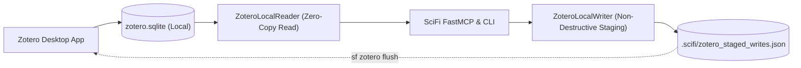

# Zotero Integration

SciFi provides direct, zero-copy read integration with your local Zotero library and safe, non-destructive staging for manuscript audits.

---

## Zero-Copy Local Architecture

Unlike cloud sync integrations that require API tokens and network calls, SciFi inspects your local Zotero installation directly:



1. **Auto-Discovery**: SciFi automatically locates your local Zotero data directory across Windows, macOS, and Linux standard paths (e.g. `%APPDATA%\Zotero\Zotero\Profiles\...` or `~/Zotero`).
2. **Offline Resilience**: Reads collections, item metadata, and PDF storage paths even when the Zotero desktop application is completely offline.
3. **Non-Destructive Staging**: Audit notes and tags are staged locally in `.scifi/zotero_staged_writes.json` and flushed via Zotero's local loopback port (`23119`) when Zotero is running.

---

## CLI Commands

### Status Check
Check Zotero database detection and local server status:
```bash
sf zotero status
```

### Sync Collection (Bi-Directional)
Synchronize papers between your Zotero collection and `references.bib`, and flush any staged writes:
```bash
sf zotero sync --collection "NeurIPS 2026 Submission"
```

### Continuous Auto-Sync Watcher
Watch `zotero.sqlite`, `references.bib`, and Zotero's local server for changes and sync automatically across the current project or all registered projects:
```bash
sf zotero watch --interval 5
sf zotero watch --all --interval 5
```

> [!NOTE]
> When `auto_sync = true` in `.scifi/config.toml` (enabled by default in `sf scaffold` and `sf adapt`), the SciFi FastMCP server runs a background sync loop automatically, and `sf` project commands trigger a lightweight fingerprint-checked sync automatically. Set `SCIFI_ZOTERO_AUTO_SYNC=0` or `auto_sync = false` to disable.

### Read Annotations
Retrieve highlighted text, margin comments, and color codes for a paper:
```bash
sf zotero annotations --key "ABC123XY"
```

### Flush Staged Writes
Flush staged audit notes and tags to Zotero:
```bash
sf zotero flush
```

---

## FastMCP Tools

AI agents can interact with Zotero directly using the FastMCP tools in `routers.zotero`:
- `scifi_zotero_status()`: Verify library detection, auto-sync status, pending writes, and collections.
- `scifi_zotero_sync(collection)`: Run bi-directional sync between the Zotero collection, `references.bib`, and staged writes.
- `scifi_zotero_search(query, collection, has_pdf, limit)`: Search across the entire Zotero library or a specific collection by keyword, title, author, DOI, arXiv ID, or tag with compact metadata.
- `scifi_zotero_get_collection_papers(collection)`: Retrieve collection papers with local PDF paths.
- `scifi_zotero_get_annotations(item_key)`: Extract highlights and notes for synthesis.
- `scifi_zotero_push_audit_note(item_key, audit_data)`: Attach structured SciFi audit cards as child notes.
